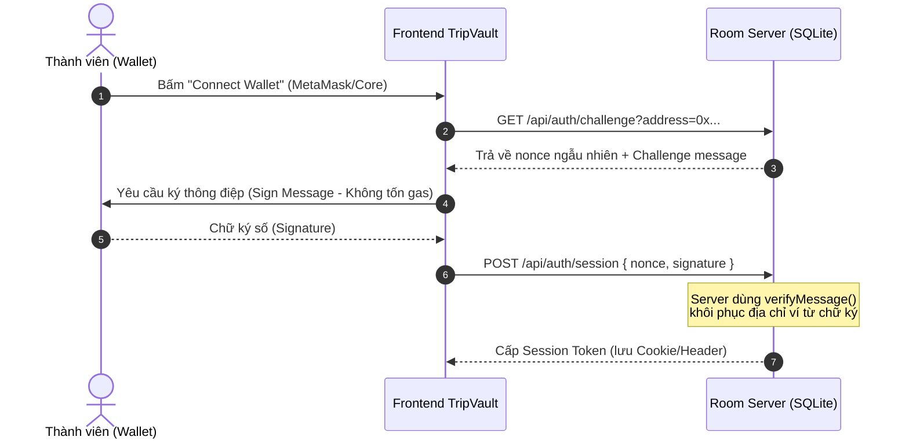

# TripVault · Hướng Dẫn Kỹ Thuật Dành Cho Thành Viên Nhóm (Team Guide)

> **Chào mừng các thành viên trong nhóm!**  
> Tài liệu này được thiết kế nhằm giúp các developer mới và thành viên trong đội ngũ hiểu rõ cơ chế vận hành, kiến trúc kết nối Web2 + Web3, logic bảo mật và luồng dữ liệu của dự án **TripVault** trên hệ sinh thái **Avalanche**.

---

## 1. Ý Tưởng Cốt Lõi (The Core Concept)

Khi đi du lịch theo nhóm, việc chia tiền thường gặp 2 vấn đề nhức nhối:
1. **Ứng tiền mặt:** Một người đứng ra trả tiền ăn, khách sạn bằng tiền mặt (VND), sau chuyến đi việc đòi lại tiền rất phiền toái hoặc bị "bùng nợ".
2. **Biến động & Khó khăn quy đổi:** Tỷ giá không rõ ràng, tính toán nợ chéo phức tạp.

**Giải pháp của TripVault:**
* **Bảo chứng On-Chain (Avalanche Fuji):** Trước chuyến đi, mỗi thành viên đặt cọc một khoản USDC vào Smart Contract Escrow có khóa thời gian. Tiền bị khóa an toàn trong suốt chuyến đi.
* **Chi tiêu Off-Chain (VND):** Trong chuyến đi, các hóa đơn phát sinh bằng VND được ghi nhận nhanh chóng ngoài app, thành viên tự duyệt các khoản liên quan đến mình.
* **Thanh toán Bù trừ Tự động (Net Split Settlement):** Khi chuyến đi kết thúc, hệ thống quy đổi tổng nợ VND sang USDC theo tỷ giá thị trường được khóa đồng thuận, hợp đồng tự động điều chỉnh số dư và hoàn trả tiền thừa về ví từng người.

---

## 2. Kiến Trúc Kết Nối & Xác Thực Ví (Wallet & SIWE Mechanism)

TripVault **không sử dụng mật khẩu hay email**. Hệ thống định danh người dùng hoàn toàn bằng địa chỉ ví Web3 thông qua chuẩn **EIP-4361: Sign-In with Ethereum (SIWE)**.



### Tại sao làm như vậy?
* **Không tốn phí Gas:** Ký thông điệp đăng nhập hoàn toàn miễn phí.
* **Bảo mật tuyệt đối:** Server không lưu trữ Private Key của người dùng; chỉ lưu chữ ký để kiểm chứng quyền sở hữu địa chỉ ví.

---

## 3. Vòng Đời Phòng Du Lịch (Room Lifecycle)

Mỗi chuyến đi được đại diện bằng một **Room** trên Server:
1. **Tạo phòng (Create Room):** Organizer tạo phòng với các mốc thời gian:
   * `depositDeadline`: Hạn chót các thành viên phải nạp cọc USDC.
   * `startTime`: Thời điểm chuyến đi bắt đầu (kể từ lúc này, cọc bị khóa cứng, không ai được tự ý rút).
   * `endTime`: Thời điểm kết thúc chuyến đi (mở khóa cổng quyết toán nợ).
   * `minimumUnits`: Mức cọc tối thiểu (ví dụ: 20 USDC).
2. **Gia nhập (Join Room):** Thành viên nhập **mã code 6 chữ số** (ví dụ: `849201`) để tham gia phòng.
3. **Triển khai Quỹ On-chain (Deploy Fuji Vault):** Sau khi đủ người, Organizer kích hoạt deploy Smart Contract lên Avalanche Fuji. Danh sách thành viên được khóa cố định on-chain.

---

## 4. Quản Lý Hóa Đơn (Bill Splitting & Approvals)

* **Ghi nhận hóa đơn:** Bất kỳ ai trả tiền bên ngoài bằng VND đều có thể thêm bill (ví dụ: Bữa trưa 600,000 VND do An trả, có An, Bình, Cường tham gia).
* **Trạng thái Bill:**
  * `pending`: Chờ các thành viên có tên trong bill vào bấm "Duyệt" (Approve).
  * `approved`: Khi tất cả người tham gia đều đã xác nhận số tiền là chính xác.
  * `disputed`: Nếu có ai đó thấy sai và gửi ý kiến phản hồi/từ chối.
* **Chặn gian lận:** Chỉ những bill có trạng thái `approved` mới được đưa vào kế hoạch quyết toán cuối cùng.

---

## 5. Toán Học Quy Đổi & Thuật Toán Zero-Sum (Bảo Toàn Tổng = 0)

### Thách thức kỹ thuật:
Smart contract trên blockchain yêu cầu:
$$\sum_{i=1}^{N} changes[i] \equiv 0$$
Tức là tổng số tiền người nợ trả ra phải bằng chính xác tổng số tiền người nhận được hưởng (bảo toàn tài sản, không tự sinh ra hay biến mất token).

Khi quy đổi từ số nguyên VND sang micro-USDC ($1 \text{ USDC} = 1,000,000 \text{ units}$), các phép chia làm tròn có thể gây ra sai lệch $\pm 1$ hoặc $\pm 2$ units (Rounding Drift).

### Cách TripVault giải quyết (Zero-Sum Balancer):
1. **Tính Net Balance VND:** Tính tổng thu - tổng chi VND của từng người. Đảm bảo tổng Net VND của cả phòng luôn $= 0$.
2. **Quy đổi sơ bộ sang Units:**
   $$targetUnits[i] = \text{Math.round}\left(\frac{netVnd[i] \times 1,000,000}{rate}\right)$$
3. **Kiểm tra độ lệch $\Delta$:**
   $$\Delta = \sum targetUnits[i]$$
4. **Bù trừ sai số:** Nếu $\Delta \neq 0$, hệ thống tự động cộng/trừ $\Delta$ vào thành viên có phần dư làm tròn lớn nhất để triệt tiêu độ lệch.
5. **Sinh `planHash`:**
   $$planHash = \text{keccak256}(\text{abi.encode}(contractAddress, revision, changes))$$
   Tất cả thành viên sẽ ký duyệt trên chính chuỗi băm `planHash` này.

---

## 6. Vòng Đời Smart Contract Trên Avalanche Fuji

Smart contract `TripVaultDeadline.sol` vận hành như một máy trạng thái (State Machine):

```ini
                       [Deploy Contract]
                              │
                    ┌─────────┴─────────┐
                    ▼                   ▼
            [Tất cả nạp cọc]     [Có người không nạp trước deadline]
                    │                   │
                    ▼                   ▼
             [Trip Active]      [Funding Failed: Rút cọc ngay]
                    │
                    ▼
           [Chuyến đi kết thúc]
                    │
                    ▼
           [Organizer Propose]
                    │
                    ▼
        [100% Thành viên Approve]
                    │
                    ▼
           [Organizer Settle]
                    │
                    ▼
           [Từng người Claim]
```

### Các hàm cốt lõi cần nhớ:
* `deposit(amount)`: Nạp USDC vào quỹ.
* `depositForPlan(amount, planHash)`: Dành cho thành viên bị âm số dư nạp bù khoản thiếu trước khi settle.
* `propose(changes[])`: Organizer công bố kế hoạch thanh toán bù trừ.
* `approve(planHash, true)`: Thành viên duyệt phương án thanh toán.
* `settle(planHash)`: Organizer chốt sổ trên hợp đồng sau khi đủ 100% duyệt.
* `claim()`: Thành viên rút USDC còn lại của mình về ví cá nhân.
* `endTripEarly()`: Cho phép Organizer kết thúc chuyến đi sớm hơn dự kiến.
* `refundDeadline`: Cơ chế an toàn 7 ngày sau khi kết thúc chuyến đi. Nếu nhóm xảy ra mâu thuẫn không thể đạt 100% đồng thuận để settle, mọi người được quyền rút lại 100% số tiền cọc ban đầu đã gửi.

---

## 7. Cẩm Nang Dành Cho Lập Trình Viên Mới

1. **Không sửa đổi trực tiếp logic toán học trong UI:** Toàn bộ công thức chia tiền nằm tại `packages/core`. Khi cần sửa đổi công thức, luôn viết test trước tại `core/test`.
2. **Tuân thủ quy trình ghi nhật ký:** Mọi thay đổi mã nguồn phải được ghi nhận vào file `REFACTORING_LOG.md` theo mẫu quy định.
3. **Chạy test thường xuyên:** Đảm bảo test suite luôn đạt 100% PASS trước khi commit.
